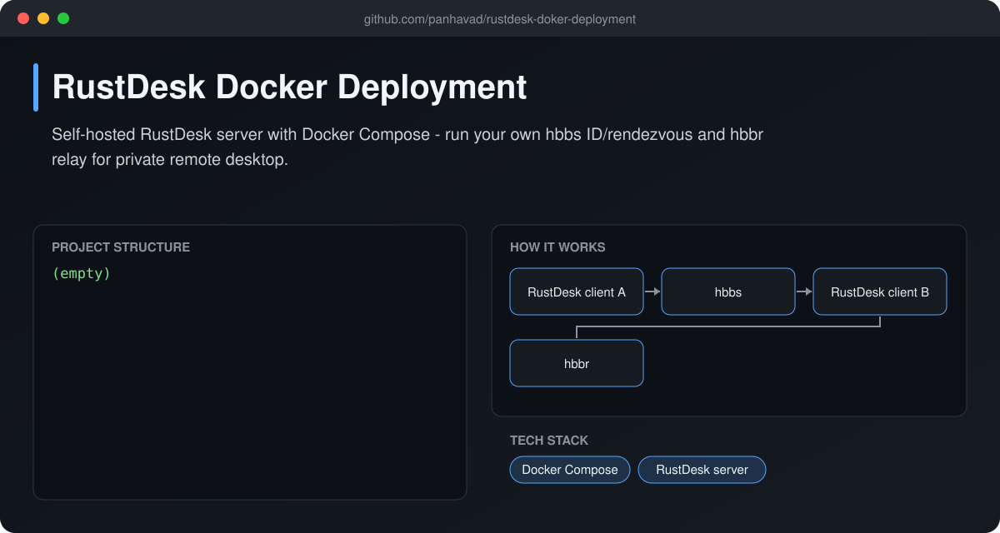
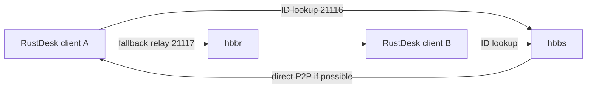

# RustDesk Docker Deployment

 [](https://github.com/panhavad/rustdesk-doker-deployment/releases/latest)

Run your own **self-hosted RustDesk server** with Docker Compose. It starts the **hbbs** (ID / rendezvous) and **hbbr** (relay) services so your remote-desktop traffic stays on your own server.



## Features

- hbbs + hbbr in one compose file
- Persistent keys in `./data`
- Host networking for easy NAT traversal
- Auto restart

## How it works



## Getting started

```bash
docker compose up -d
cat data/id_ed25519.pub   # public key for clients
```
In the RustDesk client set **ID server** to your host and paste the key.

## Download

Grab the packaged source from the [latest release](https://github.com/panhavad/rustdesk-doker-deployment/releases/latest).

## Tech stack

- Docker Compose
- RustDesk server

## Project structure

```text
rustdesk-doker-deployment/
├── docs/
├── compose.yaml
└── README.md
```
